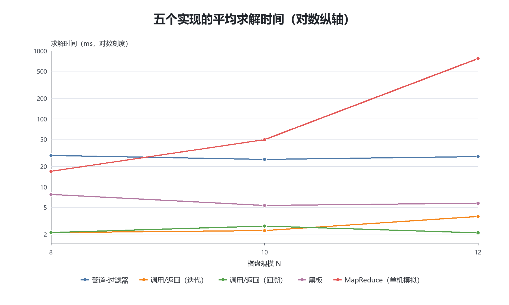
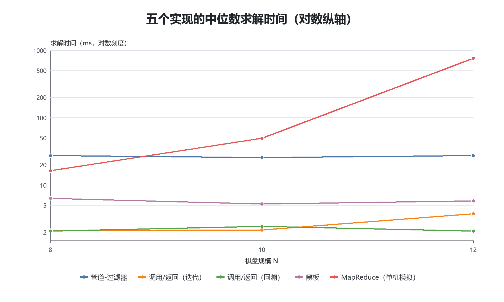
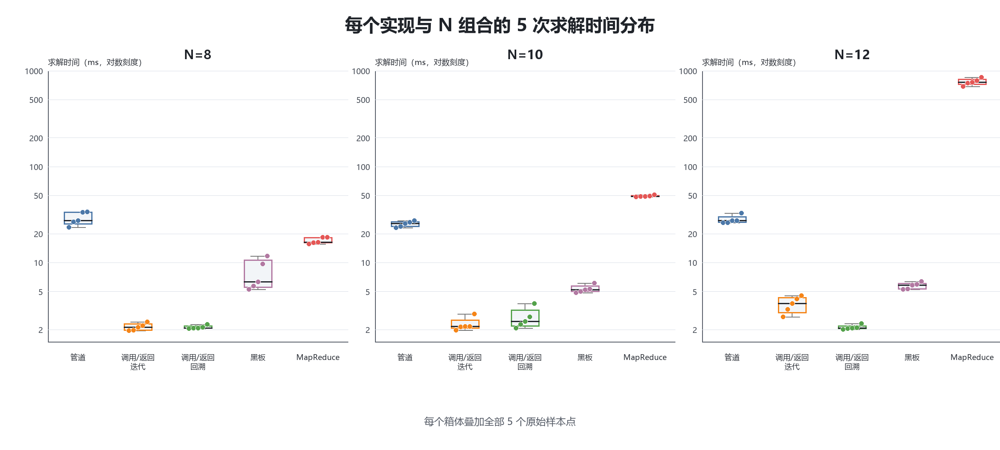
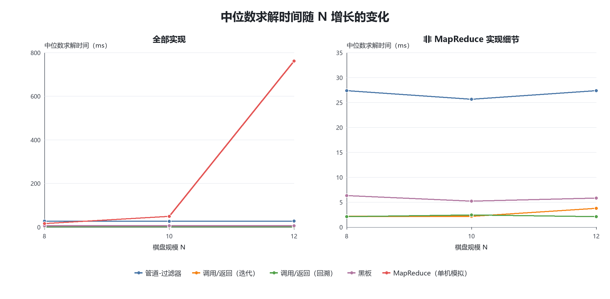

# N 皇后问题五种实现版本的软件体系架构设计与比较

## 摘要

本项目以 N 皇后问题为统一计算任务，分别实现管道-过滤器、调用/返回（迭代）、调用/返回（回溯）、黑板和 MapReduce（单机模拟）五个版本。其中，迭代与回溯是同一调用/返回架构风格下的两种实现。为提高比较的公平性，五个版本均采用逐行放置、逐列尝试的确定性搜索顺序，并使用列、`row-col+n-1` 对角线和 `row+col` 对角线三个 `long` 位向量进行冲突剪枝，找到首个合法解后返回。实验在 Windows 11、Intel Core i9-13900H 和 JDK 17.0.12 环境中，对 N=8、10、12 的 15 个“实现版本×规模”组合各独立运行 5 次，共完成 75 次无预热实验。结果表明，两个调用/返回版本总体处于相近的数毫秒级；管道-过滤器和黑板版本体现了更明确的组件协作机制，同时承担相应的通信或调度成本；MapReduce 单机模拟在 N=12 时出现明显耗时增长。实验说明，体系架构选择不能只依据单次运行时间，还应综合组件边界、连接方式、维护性、扩展需求和部署环境判断。

**关键词：** N 皇后问题；软件体系架构；管道-过滤器；调用/返回；黑板；MapReduce

## 1 项目背景与目标

### 1.1 项目背景

软件体系架构关注系统如何由组件和连接器组织，以及控制和数据如何在组件之间流动。同一个计算问题可以在保持输入、输出和核心求解规则一致的前提下，采用不同的结构组织方式。不同方式不仅影响代码划分，也会影响耦合程度、可维护性、可扩展性和运行时开销。

N 皇后问题定义明确、结果容易验证，同时包含候选生成、约束检查、状态推进和结果判定等环节，适合用作多个架构实现的共同任务。以同一问题作为基线，可以把比较重点放在体系架构差异上，而不是放在互不相同的问题或算法上。

### 1.2 项目目标

本项目的重点不是单纯寻找最快的求解方法，而是用不同体系架构组织同一个求解任务。具体目标包括：比较各版本的组件划分和连接器形式；分析控制权的集中或分散方式；比较调用传参、管道消息、共享黑板和中间任务等数据组织方法；讨论不同结构的耦合、维护性和扩展性；并在统一实验条件下观察这些组织机制在当前实现中带来的性能差异。

### 1.3 本项目主要工作

项目完成了管道-过滤器、调用/返回（迭代）、调用/返回（回溯）、黑板和 MapReduce（单机模拟）五个实现版本；统一了问题定义、搜索顺序、首解目标和三个位向量剪枝；建立了公共求解接口、结果对象、合法性验证及命令行输出协议；完成 5 个版本、3 个 N、每组 5 次的 75 次正式实验；由原始日志生成明细统计、汇总统计、增长倍率和四张实验图；最后从结构与运行表现两个方面分析不同架构的工程权衡。

## 2 N 皇后问题与统一求解策略

### 2.1 N 皇后问题

N 皇后问题要求在一个 N×N 棋盘上放置 N 个皇后，使任意两个皇后都不位于同一列或同一条对角线上。由于本项目按行依次放置皇后，每一行只放置一个皇后，因此搜索时无需再检查行冲突，只需判断列与两类对角线冲突。

项目使用一维数组表示棋盘结果：数组下标表示行，数组值表示该行皇后所在的列，列下标从 0 开始。例如，N=4 的首解 `[1,3,0,2]` 表示第 0 至第 3 行的皇后依次位于第 1、3、0、2 列。

### 2.2 求解目标

五个实现版本的目标均为寻找并返回固定搜索顺序下的第一个合法解，而不是枚举全部解。N 的公共输入范围为 1 至 15；有解时返回长度为 N 的列数组，无解时返回空数组并标记未找到解。实验选择 N=8、10、12，三种规模均存在解。

### 2.3 基本搜索过程

统一搜索从第 0 行开始，按行递增推进。对当前行，候选列按照 `0..N-1` 的顺序尝试：若候选位置与已放置皇后冲突，则立即剪枝；若合法，则记录该位置并进入下一行；后续无法完成时撤销当前位置并继续尝试下一列。当行号达到 N 时得到完整解并立即返回。

管道-过滤器、两个调用/返回版本和黑板版本以深度优先方式组织上述过程；MapReduce 单机模拟按层展开搜索状态，并使用顺序值恢复与统一列顺序一致的首解。它们的架构控制方式不同，但问题定义和结果顺序保持一致。

### 2.4 三个位向量剪枝

真实实现使用三个 `long` 位向量保存占用情况：

- `columnsMask`（黑板实现中的对应字段为 `occupiedColumns`）表示已占用列，第 `col` 位对应列 `col`；
- `diag1Mask`（黑板实现中的对应字段为 `occupiedLeftDiagonals`）表示索引为 `row-col+n-1` 的对角线；
- `diag2Mask`（黑板实现中的对应字段为 `occupiedRightDiagonals`）表示索引为 `row+col` 的对角线。

尝试位置 `(row, col)` 时，程序分别构造 `1L << col`、`1L << (row-col+n-1)` 和 `1L << (row+col)`。如果相应位已被占用，该候选立即被排除；否则放置皇后并更新三个位向量，回退时再撤销相应位。该方法以常数时间完成一次冲突判断，并且五个版本使用等价规则。

### 2.5 统一搜索策略与公平比较原则

为了尽可能减少求解算法差异对架构比较的影响，本项目统一了问题定义、首解目标、搜索顺序以及核心剪枝策略，使实验更多反映不同软件体系架构组织方式带来的实现特征和额外开销。五个版本均按行递增、按列从小到大尝试，不使用对称性优化、答案缓存、随机搜索或额外启发式剪枝，并返回相同顺序下的首解。

这种控制变量方式虽然增强了实验可比性，但也会限制各架构针对自身特点进行专门优化，因此实验结果只表示当前实现条件下的表现，不能作为某种架构在所有场景中的绝对性能结论。例如，单机模拟版本没有利用分布式环境，而其他版本也没有为了特定 N 改变搜索次序。

## 3 系统总体设计

### 3.1 项目总体结构

项目按职责划分为五个核心目录：`src/` 保存公共入口、公共契约和五个版本的 Java 实现；`tests/` 保存公共契约检查与管道-过滤器专项检查；`scripts/` 提供编译、单次调试、批量正式实验和进程输出采集；`experiments/` 保存正式原始日志及由其生成的 CSV、图表和分析文档；`docs/` 保存接口、实验规则、公共基线、审计和最终报告等说明材料。该组织将生产代码、验证代码、实验数据和文档分离，便于独立检查与维护。

### 3.2 五个实现版本概览

| 实现版本 | 架构风格/组织形式 | 核心特点 |
|---|---|---|
| 管道-过滤器 | 管道-过滤器 | 将输入、候选生成、合法性校验、完整解收集和结果输出分成阶段，通过阻塞队列 Pipe 传递消息 |
| 调用/返回（迭代） | 调用/返回 | 以同步方法调用组织层次，求解层使用循环和每行候选游标显式推进、回退 |
| 调用/返回（回溯） | 调用/返回 | 以同步方法调用组织层次，求解层使用递归调用栈完成推进与回退 |
| 黑板 | 黑板 | 控制器调度多个知识源，知识源只通过集中黑板读取和更新状态 |
| MapReduce（单机模拟） | MapReduce 思想的单机模拟 | 将逐层候选处理组织为 Map、Shuffle、Reduce 三阶段，以记录流、分组和 frontier 传递中间结果 |

调用/返回（迭代）和调用/返回（回溯）属于同一个调用/返回架构风格下的两个不同实现版本。因此，本项目比较的是五个实现版本，而不是五种彼此完全独立的架构风格。

### 3.3 公共接口与统一输入输出

五个版本均实现公共 `Solver` 接口，其唯一方法为 `SolveResult solve(int n)`。`SolveResult` 包含 `found` 和 `columns`：`found` 表示是否找到解，`columns` 按行保存零基列下标；结果对象在构造和读取数组时均进行复制，避免外部修改内部结果。

统一命令行入口为 `nqueens.cli.Main`，输入格式为 `--architecture <id> --n <1..15>`。其中架构标识分别为 `pipefilter`、`callreturn-iterative`、`callreturn-backtracking`、`blackboard` 和 `mapreduce`。入口根据标识创建相应求解器，调用 `solve` 后再由公共 `ResultValidator` 验证结果合法性，验证器不参与搜索。

正常标准输出只有一行 JSON，包含 `protocol_version`、`architecture`、`n`、`mode`、`status`、`columns` 和 `solve_elapsed_ns`。`mode` 固定为 `first`；`status` 可表示已求解、无解、未实现或错误；`columns` 使用统一结果格式；`solve_elapsed_ns` 表示公共入口包围 `solver.solve(n)` 所测得的纳秒数。诊断信息写入标准错误流，从而便于脚本分别保存和解析。

## 4 五个实现版本的架构设计与实现

### 4.1 管道-过滤器

#### 4.1.1 架构思想

本实现将 N 皇后首解求解拆分为输入、部分解生成、合法性校验、完整解收集和结果转换五个处理阶段。输入组件负责发布空棋盘；生成过滤器负责按顺序产生候选；校验过滤器使用三个位向量排除冲突候选；收集过滤器区分完整解与仍需展开的部分解；输出过滤器把管道内部的终止事件转换为公共 `SolveResult`。每个阶段只处理自己的职责，不把全部搜索过程集中在一个方法中。

各过滤器没有保存其他过滤器实例，也不调用彼此的内部方法，而是通过 `Pipe<T>` 读取上游消息并写入下游消息。主链路按“生成—校验—收集—输出”传递数据，尚未完成的合法状态再经反馈 Pipe 回到生成过滤器。`Pipe<T>` 因而承担组件连接器的角色，既隔离了组件实现，也使数据流、反馈流和终止信号具有明确边界。

#### 4.1.2 组件

| 组件 | 对应 Java 类/方法 | 主要职责 |
|---|---|---|
| 求解器装配组件 | `ArchitectureSolver.solve(int)` | 校验 N，创建五条 Pipe 和固定四线程执行器，装配并启动各过滤器，等待结果和工作线程结束，最后回收线程资源 |
| 输入组件 | `InputComponent.publish()` | 根据 N 创建空棋盘 `SearchState`，并将其写入 `initialStatePipe`；该组件在调用线程执行，不占用工作线程 |
| 部分解生成过滤器 | `PartialSolutionGenerationFilter` | 维护私有 DFS 栈；对取出的父状态按列从小到大产生 `Candidate`，发送批次结束消息，并接收合法子状态反馈 |
| 合法性校验过滤器 | `LegalityValidationFilter` | 检查列、`row-col+n-1` 对角线和 `row+col` 对角线位向量；丢弃冲突候选，为合法候选构造下一行 `SearchState` |
| 完整解收集过滤器 | `CompleteSolutionCollectionFilter` | 按批次收集合法状态；将未完成状态反馈给生成过滤器，将首个完整状态或无解结果发送到结果 Pipe |
| 结果输出过滤器 | `ResultOutputFilter.call()` | 读取 `Solved`、`NoSolution` 或 `ResultFailure`，转换为 `SolveResult` 或抛出对应异常；不直接打印标准输出 |

`ArchitectureSolver` 是装配与资源管理组件，不承担候选检查；`InputComponent` 负责初始数据注入，也不是工作线程中的 Filter。真正由四个工作线程运行的是生成、校验、收集和结果输出四个组件，其中前三个实现 `Runnable`，结果输出组件实现 `Callable<SolveResult>`。

#### 4.1.3 连接器

`Pipe<T>` 是项目自定义的泛型单向连接器，内部字段类型为 `BlockingQueue<T>`，实际创建的是无界 `LinkedBlockingQueue<T>`。它只提供 `put(T)` 和 `take()`：`put` 拒绝 `null` 消息并在需要时阻塞写入，`take` 在队列为空时阻塞读取。`LinkedBlockingQueue` 本身支持多线程安全访问，因此各工作线程可以通过 Pipe 交换消息，而 Pipe 不解释或修改消息中的搜索数据。

当前实现真实创建五条 Pipe，连接关系如下。

| Pipe/连接器 | 上游组件 | 下游组件 | 传递内容 |
|---|---|---|---|
| `initialStatePipe`（`Pipe<SearchState>`） | `InputComponent` | `PartialSolutionGenerationFilter` | 由 N 构造的空棋盘初始状态 |
| `candidatePipe`（`Pipe<CandidateEvent>`） | `PartialSolutionGenerationFilter` | `LegalityValidationFilter` | 候选位置、批次结束、搜索耗尽、停止或失败消息 |
| `legalStatePipe`（`Pipe<LegalEvent>`） | `LegalityValidationFilter` | `CompleteSolutionCollectionFilter` | 合法子状态以及批次结束、搜索耗尽、停止或失败消息 |
| `feedbackPipe`（`Pipe<FeedbackEvent>`） | `CompleteSolutionCollectionFilter` | `PartialSolutionGenerationFilter` | 一批未完成合法状态 `ChildrenBatch`，或停止消息 `FeedbackStop` |
| `completeSolutionPipe`（`Pipe<ResultEvent>`） | `CompleteSolutionCollectionFilter` | `ResultOutputFilter` | 首解 `Solved`、无解 `NoSolution` 或失败 `ResultFailure` |

#### 4.1.4 控制流

`ArchitectureSolver.solve(int)` 首先创建五条 Pipe 和四线程执行器，依次提交生成、校验、收集和结果输出组件。随后，调用线程执行 `InputComponent.publish()`，把 `SearchState.initial(n)` 放入初始状态 Pipe。主要处理链路为：

```text
InputComponent
→ initialStatePipe
→ PartialSolutionGenerationFilter
→ candidatePipe
→ LegalityValidationFilter
→ legalStatePipe
→ CompleteSolutionCollectionFilter
→ completeSolutionPipe
→ ResultOutputFilter
→ SolveResult
```

生成过滤器从私有 `ArrayDeque<SearchState>` 弹出一个父状态，按列升序发送该父状态的全部 `Candidate`，再发送 `CandidateBatchEnd`。校验过滤器只把合法候选转换成 `LegalState`，并将批次结束消息继续传递。收集过滤器在一个批次内暂存未完成的合法子状态；如果没有完整解，则以 `ChildrenBatch` 经 `feedbackPipe` 返回。生成过滤器将这批状态逆序压栈，使最小列对应状态先被处理，从而保持确定性的深度优先首解顺序。

找到完整解时，收集过滤器在批次结束处向结果 Pipe 写入 `Solved`，并向反馈 Pipe 写入 `FeedbackStop`。生成过滤器收到后发送 `CandidateStop`，校验过滤器再转发为 `LegalStop` 并退出。若 DFS 栈耗尽，生成过滤器发送 `CandidateSearchExhausted`，该信号经校验阶段转为 `LegalSearchExhausted`，收集过滤器最终发送 `NoSolution`。失败也通过 `CandidateFailure`、`LegalFailure` 或 `ResultFailure` 沿相应 Pipe 传播；装配器在异常情况下取消工作任务并调用 `shutdownNow()`，正常情况下调用 `shutdown()`，两种路径都会等待执行器终止。

#### 4.1.5 数据传递方式

过滤器之间传递的是 `SearchState` 和 `PipelineProtocol` 定义的协议消息。`SearchState` 保存棋盘规模 `n`、下一待放置行 `row`、按行记录皇后列位置的 `columns`，以及 `columnsMask`、`diag1Mask`、`diag2Mask` 三个位向量。候选校验通过后，校验过滤器复制父状态的列数组、写入当前列并构造新的 `SearchState`，因此搜索状态随着管道向下游推进，而不是由下游直接修改上游对象。

候选管道使用 `CandidateEvent`，包括 `Candidate`、`CandidateBatchEnd`、`CandidateSearchExhausted`、`CandidateStop` 和 `CandidateFailure`；合法状态管道使用对应的 `LegalEvent`；反馈管道传递 `ChildrenBatch` 或 `FeedbackStop`；结果管道传递 `Solved`、`NoSolution` 或 `ResultFailure`。批次、停止和无解信号由枚举单例表达，数据消息主要由 record 表达。

在搜索数据范围内，这些跨组件对象按不可变方式设计：`SearchState` 的字段为私有 `final`，`columns` 在构造和读取时都复制；`ChildrenBatch` 使用 `List.copyOf`；`Solved` 在构造和读取结果数组时都复制。生成过滤器的 DFS 栈和收集过滤器的批次列表是各自线程私有的可变对象，不跨组件共享。失败消息虽然携带 `Throwable` 引用，但该引用用于传递异常，不承载可变搜索状态。

#### 4.1.6 架构约束

| 架构约束 | 本项目实现方式 | 对应代码 |
|---|---|---|
| 过滤器通过 Pipe 通信 | 生成、校验、收集和输出组件只持有所需 Pipe，不持有或调用相邻过滤器实例 | 各 Filter 的构造字段；`Pipe.put()`、`Pipe.take()` |
| 处理职责分离 | 候选生成、冲突检查、完整解判定和公共结果转换分别由独立类负责 | `PartialSolutionGenerationFilter`、`LegalityValidationFilter`、`CompleteSolutionCollectionFilter`、`ResultOutputFilter` |
| 消息边界明确 | 搜索数据、批次边界、耗尽、停止、失败和结果均使用规定类型传递 | `SearchState`、`PipelineProtocol` 中的 sealed interface、record 和 enum |
| 搜索由管道关系组织 | 四个工作组件并发等待 Pipe 消息，装配器不直接依次调用各过滤器的处理方法 | `ArchitectureSolver.solve(int)` 的 Pipe 装配和 `executor.submit(...)` |
| 不共享可变搜索状态 | 搜索状态和结果数组防御性复制；DFS 栈与批次缓冲分别限定在单个过滤器内部 | `SearchState`、`ChildrenBatch`、`Solved`、`generate()`、`collect()` |
| 资源生命周期统一管理 | 五条 Pipe、执行器和组件均在单次 `solve` 内创建；返回前等待任务，并在 `finally` 中关闭执行器 | `ArchitectureSolver.solve(int)`、`awaitTermination(...)` |
| 终止与失败通过协议传播 | 首解、无解、停止和失败都有专门消息；异常路径会取消任务并强制关闭执行器 | `FeedbackStop`、`CandidateStop`、`LegalStop`、`NoSolution`、各类 `Failure` 消息 |
| 保持统一搜索基线 | 按行推进、按列升序生成，合法子状态逆序压栈；只用三个位向量剪枝 | `PartialSolutionGenerationFilter.generate()`、`pushInDepthFirstOrder(...)`、`LegalityValidationFilter.validate(...)` |

#### 4.1.7 代码映射

| 架构角色 | Java 类/方法 | 代码职责 |
|---|---|---|
| 公共求解入口与装配 | `ArchitectureSolver.solve(int)` | 创建连接器和组件，启动四个工作任务，注入输入，等待结果，处理异常与资源回收 |
| 输入组件 | `InputComponent.publish()` | 将 `SearchState.initial(n)` 写入 `initialStatePipe` |
| Pipe 连接器 | `Pipe<T>.put()`、`Pipe<T>.take()` | 封装 `LinkedBlockingQueue`，提供线程安全的阻塞式单向消息传递 |
| 生成 Filter | `PartialSolutionGenerationFilter.generate()` | 使用私有 DFS 栈展开父状态，发送候选和批次结束事件，接收反馈批次或停止信号 |
| DFS 顺序恢复 | `PartialSolutionGenerationFilter.pushInDepthFirstOrder(...)` | 将合法子状态逆序压栈，使列较小的状态先被搜索 |
| 校验 Filter | `LegalityValidationFilter.validateCandidates()`、`validate(...)` | 消费候选事件，以三个位向量判断冲突并产生新的合法搜索状态，同时转发控制事件 |
| 收集 Filter | `CompleteSolutionCollectionFilter.collect()` | 缓冲未完成合法状态，识别批次中的首个完整解，发送反馈、无解、结果或失败消息 |
| 输出 Filter | `ResultOutputFilter.call()` | 将内部 `ResultEvent` 转换为公共 `SolveResult`，或将失败重新抛出 |
| 搜索状态 | `SearchState` | 保存 N、当前行、列数组和三个位向量，并通过防御性复制保护数组 |
| 消息协议 | `PipelineProtocol` | 定义候选、合法状态、反馈和结果四组消息及其批次、停止、耗尽和失败语义 |
| 最终 JSON 输出 | `nqueens.cli.Main.emit(...)` | 在管道求解器返回后统一输出一行 JSON；不属于管道内部的结果过滤器 |

#### 4.1.8 特点与代价

当前实现的主要特点是处理阶段边界清楚。候选生成、约束检查、结果收集和公共结果转换可以分别理解与检查，组件之间只依赖 Pipe 中的协议类型；反馈 Pipe 又在保持阶段分离的同时支持深度优先搜索。搜索状态采用防御性复制，线程私有栈和批次缓冲也降低了跨组件共享可变状态所带来的风险。项目测试通过公共 `Solver` 入口检查 N=1、2、3、4、8、10、12 的结果与确定性，避免测试直接依赖过滤器内部实现。

这些结构也带来实际代价。一次 `solve` 需要创建四线程执行器、五条队列和多类消息对象；搜索过程中包含阻塞式 `put/take`、线程调度、状态及集合复制、反馈批次协调，以及首解、无解和异常三类收尾流程。组件替换时虽然边界明确，但消息协议、批次语义和终止传播必须保持一致。

正式数据中，管道-过滤器在 N=8、10、12 下的平均求解时间分别为 28.954 ms、25.253 ms 和 27.972 ms，整体约为 25～29 ms，高于两个调用/返回版本的数毫秒级结果。结合代码可以看出，在当前较小规模、只求首解且每次独立 JVM 首次执行的条件下，线程、队列、消息传递与组件协调等固定组织成本占比较明显。该结果反映的是本项目当前实现和实验规模下的权衡，不能据此概括所有管道-过滤器系统的性能表现。

### 4.2 调用/返回（迭代）

#### 4.2.1 架构思想

#### 4.2.2 组件

#### 4.2.3 连接器

#### 4.2.4 控制流

#### 4.2.5 状态维护方式

#### 4.2.6 架构约束

#### 4.2.7 代码映射

#### 4.2.8 特点与代价

### 4.3 调用/返回（回溯）

#### 4.3.1 架构思想

#### 4.3.2 组件

#### 4.3.3 连接器

#### 4.3.4 控制流

#### 4.3.5 状态维护方式

#### 4.3.6 架构约束

#### 4.3.7 代码映射

#### 4.3.8 特点与代价

### 4.4 黑板

#### 4.4.1 架构思想

#### 4.4.2 Blackboard

#### 4.4.3 Knowledge Source

#### 4.4.4 Controller

#### 4.4.5 数据共享方式

#### 4.4.6 控制流

#### 4.4.7 架构约束

#### 4.4.8 代码映射

#### 4.4.9 特点与代价

### 4.5 MapReduce（单机模拟）

#### 4.5.1 架构思想

#### 4.5.2 Map 阶段

#### 4.5.3 中间任务

#### 4.5.4 Reduce / 汇总阶段

#### 4.5.5 单机任务调度

#### 4.5.6 控制流

#### 4.5.7 数据传递方式

#### 4.5.8 代码映射

#### 4.5.9 特点与代价

## 5 五个实现版本的架构对比

### 5.1 组件组织方式

五个版本对相同职责采用了不同的分解方式。调用/返回两个版本按调度层、求解层和棋盘数据层形成直接层次，迭代与递归的主要区别位于求解层内部。管道-过滤器将处理过程拆分为输入、候选生成、合法性校验、完整解收集和结果输出等阶段。黑板版本由共享存储、控制器和多个知识源构成。MapReduce 单机模拟则由 Driver、Mapper、Shuffler、Reducer 以及记录和状态对象构成。由此可见，组件数量增加通常可以让职责边界更明确，但也会增加装配和协作成本。

### 5.2 连接器形式

调用/返回版本的连接器是同步方法调用、返回值以及递归调用栈或局部对象。管道-过滤器使用五条基于 `LinkedBlockingQueue` 的 Pipe，数据和控制消息都沿 Pipe 传递。黑板版本以共享的 `BlackboardStorage` 作为知识源之间的数据连接器，知识源之间不直接调用；控制器通过统一知识源接口触发规则。MapReduce 单机模拟通过 `List` 形式的 frontier、候选记录流、按候选键分组的映射以及归约结果连接各阶段。

### 5.3 控制流

两个调用/返回版本的控制流最直接：调度层同步进入求解层，迭代版本由循环管理推进与回退，回溯版本由递归调用和返回完成同一过程。管道-过滤器由多个工作线程并发运行各过滤器，主数据流向下游移动，未完成合法状态通过反馈 Pipe 返回生成阶段。黑板版本的控制权集中于 Controller，由其按候选、列检查、对角线检查和解检查的顺序调度知识源并负责回退。MapReduce 单机模拟的控制权集中于 Driver，每轮依次执行 Map、Shuffle、Reduce，再决定是否进入下一层。

### 5.4 数据传递与共享

调用/返回版本在单次求解内部传递参数并修改局部棋盘对象，不跨线程共享。管道-过滤器传递不可变搜索状态和协议消息，对数组、列表进行防御性复制，各过滤器拥有自己的栈或缓冲区。黑板版本把行号、候选列、皇后位置、位向量、状态和结果集中保存在黑板中，知识源通过读写该共享状态协作。MapReduce 单机模拟以不可变搜索状态和候选记录作为中间数据，Shuffle 后按键分组，Reducer 只将合法组推进到下一轮 frontier。

### 5.5 耦合程度

调用/返回版本依赖清晰，但求解控制与棋盘状态之间存在直接调用关系。管道-过滤器的过滤器不直接互调，主要依赖消息协议和 Pipe 接口，组件之间的直接耦合较低，但对协议一致性要求较高。黑板知识源之间没有直接依赖，耦合集中到黑板字段和控制器调度规则。MapReduce 各阶段通过记录类型、键和分组结构连接，阶段边界清晰，但中间数据契约变化会同时影响多个阶段。

### 5.6 可维护性

调用/返回结构规模小、调用路径容易理解，适合当前较紧凑的求解任务；当规则和流程继续增长时，主控制逻辑可能承担更多职责。管道-过滤器便于单独理解、替换或测试某个处理阶段，但必须同步维护消息类型、终止协议和线程资源。黑板可以将不同约束封装为独立知识源，增加规则时不必让知识源彼此建立调用关系，但需要谨慎维护共享字段语义和调度顺序。MapReduce 的三个阶段职责明确，便于定位映射、分组或归约问题，但记录、顺序和 frontier 的一致性需要贯穿维护。

### 5.7 可扩展性

管道-过滤器适合增加或替换处理阶段，也具备进一步调整各阶段执行方式的空间。黑板适合增加新的知识源，但新增规则可能要求扩充黑板状态并修改 Controller 的调度。MapReduce 的任务分解和汇总结构为批量处理或进一步并行化提供了组织基础，但当前版本是单进程、单线程模拟，不能把这种结构潜力等同于已经实现的运行能力。调用/返回版本扩展直接、改动位置明确，但随着职责增多，可能需要继续分层以避免控制逻辑集中。

### 5.8 并发与性能开销

| 实现版本 | 连接方式 | 控制特点 | 数据方式 | 可维护性特点 | 主要运行开销 |
|---|---|---|---|---|---|
| 管道-过滤器 | 五条阻塞队列 Pipe | 四个工作线程协作，含反馈路径 | 不可变状态与协议消息 | 阶段独立，协议和线程生命周期需统一维护 | 线程创建与调度、队列 put/take、消息和状态复制 |
| 调用/返回（迭代） | 同步方法调用 | 循环显式推进和回退 | 单次求解内局部可变棋盘与候选游标 | 路径直接，状态推进逻辑集中 | 方法调用、循环、位运算与显式游标维护 |
| 调用/返回（回溯） | 同步及递归调用 | 调用栈推进和返回 | 单次求解内局部棋盘与递归帧 | 递归结构贴合搜索过程 | 方法调用、递归栈、位运算和状态撤销 |
| 黑板 | 共享黑板与知识源接口 | Controller 集中调度 | 多个知识源读写同一黑板 | 规则分离，共享状态语义需一致 | 知识源调度、共享字段读写和状态回退 |
| MapReduce（单机模拟） | 记录流、按键分组和归约结果 | Driver 逐层执行三个阶段 | frontier、候选记录和分组集合 | 阶段清晰，中间数据契约较多 | 整层扩展、对象创建、分组、复制和排序 |

当前只有管道-过滤器实际创建多个工作线程；MapReduce 版本虽采用任务分解形式，但当前为单线程模拟。对于只求首解且 N=8～12 的任务，直接调用版本的附加机制较少；其他版本的组织机制在结构表达上更明显，也产生相应的固定或随中间状态增长的成本。

## 6 实验设计

### 6.1 实验目的

实验用于验证五个版本能否在统一契约下正确返回相同首解，并观察不同组件组织、连接器、控制流和数据传递机制在当前实现中的求解耗时与波动。实验结果服务于架构权衡分析，不用于给架构建立脱离场景的性能排名。

### 6.2 实验环境

- 操作系统：Windows 11；
- 处理器：Intel Core i9-13900H；
- JDK：17.0.12；
- 编译目标与编码：Java 17、UTF-8。

五个正式实验批次的环境记录内容一致，因而不同版本的结果具有共同的运行环境基础。

### 6.3 实验对象

实验对象为管道-过滤器、调用/返回（迭代）、调用/返回（回溯）、黑板和 MapReduce（单机模拟）五个实现版本。所有版本都通过同一公共命令行入口运行，并使用统一输入格式、输出协议、结果验证和计时位置。

### 6.4 实验规模

实验选择 N=8、10、12。规模为 5 个实现版本 × 3 个 N × 每组 5 次，即 15 个组合、75 次正式运行。每组固定 5 个样本，未删除或替换任何正式实验样本。

### 6.5 实验流程

正式实验脚本首先在新的构建目录中编译 Java 源码，再为指定实现依次运行 N=8、10、12，每个 N 重复 5 次。每次运行创建独立目录，分别保存完整命令、原始标准输出、原始标准错误和退出码；批次目录还保存环境、编译命令和编译输出。随后，分析脚本解析原始 JSON，检查运行数量、成功状态、结果一致性和环境一致性，并生成明细 CSV、汇总 CSV、增长倍率、图表和实验分析文档。

### 6.6 评价指标

正确性指标包括退出码、JSON 可解析性、协议版本、求解状态、结果合法性、组内及跨实现首解一致性和标准错误是否为空。性能指标以 `solve_elapsed_ns` 换算的毫秒值为基础，统计每组 5 次运行的均值、中位数、最小值、最大值和样本标准差。均值反映总体水平，中位数对少数较高或较低运行值更稳健，标准差和分布图用于观察小样本波动。

### 6.7 冷态实验计时边界

每一次实验均启动独立 JVM，并在该 JVM 中首次执行求解器，没有进行预热。公共入口先完成参数解析和求解器对象创建，再以 `System.nanoTime()` 包围 `solver.solve(n)`。因此，`solve_elapsed_ns` 只统计求解区域的执行时间，并不包含 JVM 进程启动本身的耗时，也不包含求解后的公共结果验证和 JSON 输出。

虽然计时不包含 JVM 启动过程，但被计时的是该 JVM 中的首次求解，仍可能受到 JIT 编译、类首次使用、首次代码路径执行、内存分配以及操作系统调度等冷态因素影响。因此，本报告把该指标理解为“独立 JVM 中无预热的首次核心求解耗时”，而不是端到端启动耗时或充分预热后的稳定吞吐性能。

## 7 实验结果与分析

### 7.1 数据正确性验证

`run_index.csv` 和 `raw_run_details.csv` 共记录 75 次正式运行，覆盖 15 个“实现版本×N”组合，每组恰好 5 次。75 次运行退出码均为 0，状态均为 `solved`，JSON 全部可解析，标准错误均为空；五份实验环境记录一致。

五个版本在相同 N 下返回一致首解：N=8 为 `[0,4,7,5,2,6,1,3]`，N=10 为 `[0,2,5,7,9,4,8,1,3,6]`，N=12 为 `[0,2,4,7,9,11,5,10,1,6,8,3]`。15 个组合均通过组内首解一致性检查，说明后续耗时比较建立在输出正确且搜索目标一致的基础上。

### 7.2 描述性统计

下表数据来自 `detail_results.csv`，时间单位为毫秒，显示值四舍五入到 3 位小数；标准差为每组 5 次运行的样本标准差。

| 实现版本 | N | 均值/ms | 中位数/ms | 最小值/ms | 最大值/ms | 标准差/ms |
|---|---:|---:|---:|---:|---:|---:|
| 管道-过滤器 | 8 | 28.954 | 27.338 | 23.292 | 33.885 | 4.599 |
| 管道-过滤器 | 10 | 25.253 | 25.614 | 23.155 | 27.371 | 1.728 |
| 管道-过滤器 | 12 | 27.972 | 27.376 | 26.034 | 32.845 | 2.815 |
| 调用/返回（迭代） | 8 | 2.131 | 2.113 | 1.962 | 2.413 | 0.187 |
| 调用/返回（迭代） | 10 | 2.270 | 2.157 | 1.972 | 2.924 | 0.374 |
| 调用/返回（迭代） | 12 | 3.684 | 3.730 | 2.722 | 4.527 | 0.719 |
| 调用/返回（回溯） | 8 | 2.118 | 2.074 | 2.055 | 2.273 | 0.090 |
| 调用/返回（回溯） | 10 | 2.649 | 2.432 | 2.072 | 3.750 | 0.660 |
| 调用/返回（回溯） | 12 | 2.115 | 2.069 | 2.022 | 2.319 | 0.117 |
| 黑板 | 8 | 7.747 | 6.330 | 5.273 | 11.741 | 2.830 |
| 黑板 | 10 | 5.316 | 5.208 | 4.873 | 6.144 | 0.494 |
| 黑板 | 12 | 5.727 | 5.804 | 5.243 | 6.352 | 0.455 |
| MapReduce（单机模拟） | 8 | 16.956 | 16.303 | 15.714 | 18.337 | 1.278 |
| MapReduce（单机模拟） | 10 | 49.405 | 49.206 | 48.472 | 51.036 | 1.002 |
| MapReduce（单机模拟） | 12 | 767.118 | 760.901 | 690.440 | 853.453 | 60.037 |

### 7.3 平均求解时间比较



两个调用/返回版本在三个 N 下的平均耗时均处于约 2～4 ms。黑板版本平均值约为 5～8 ms，管道-过滤器约为 25～29 ms。MapReduce 单机模拟从 N=8 的 16.956 ms 增长到 N=10 的 49.405 ms，并在 N=12 达到 767.118 ms。由于不同数量级同时出现，平均值图采用对数纵轴更便于比较整体差异。

黑板在 N=8 时平均值为 7.747 ms，中位数为 6.330 ms，说明少数较高耗时会影响小样本平均值，因此同时参考中位数更为稳妥。管道-过滤器三个 N 的平均值没有随 N 单调增加，提示在这些规模下固定组织成本和冷态波动可能占有较明显比例。

### 7.4 中位数求解时间比较



中位数结果与均值的总体量级一致。调用/返回（迭代）三个 N 的中位数为 2.113、2.157、3.730 ms；调用/返回（回溯）为 2.074、2.432、2.069 ms。两个调用/返回版本总体处于相近的数毫秒级。考虑到每个组合仅运行五次且没有预热，细小差异可能与冷态执行和计时噪声处于相近量级，因此不足以支持绝对性能优劣判断。

MapReduce 单机模拟在 N=8、10、12 下的中位数分别为 16.303、49.206、760.901 ms，增长趋势明显。管道-过滤器的中位数保持在 25～28 ms 左右；黑板在三个 N 下为 5～7 ms 左右。

### 7.5 五次运行的波动情况



分布图展示每个组合的全部 5 个样本点，并使用对数纵轴覆盖约 2 ms 到数百毫秒的范围。调用/返回（回溯）在 N=8 和 N=12 下的样本较集中；调用/返回（迭代）N=12 的范围为 2.722～4.527 ms。黑板 N=8 的范围为 5.273～11.741 ms，均值因较高运行值而高于中位数。管道-过滤器各组存在一定波动，但整体仍在几十毫秒范围。

MapReduce N=12 的五次运行范围为 690.440～853.453 ms，全部处于数百毫秒级。因此，该组合的高耗时不是由单个样本造成的，其量级差异已经明显大于其他实现中的数毫秒级波动。

### 7.6 随 N 增大的性能变化



由 `runtime_growth_ratio.csv` 可知，MapReduce 单机模拟从 N=10 到 N=12 的中位数约增长 15.46 倍，从 N=8 到 N=12 约增长 46.67 倍。当前实现逐层扩展整个 frontier，并对候选记录进行分类、分组、复制和排序；随着中间状态数量增加，这些工作在 N=12 下显著放大。

其他版本的耗时并不全部随 N 单调增长。原因是本实验只求首解，而不是枚举全部解；不同 N 在固定搜索顺序下到达首解所经历的搜索路径不同；每组只有 5 次样本且均为冷态首次求解；同时，线程、队列、组件调度等固定架构成本在较小问题规模中可能占比较高。因此，这些数据不能用于断言所有实现都应随 N 单调变慢，也不能据此严格推导算法时间复杂度。

### 7.7 架构机制与实验结果对应分析

管道-过滤器在每次 `solve` 中创建五条 Pipe 和四个工作线程。候选生成、合法性校验、完整解收集和结果转换分别运行，未完成状态还要经反馈 Pipe 返回。该结构明确表达了阶段边界和消息流，但线程创建、队列阻塞操作、协议消息、组件协调和状态复制构成固定开销。在当前实现和当前问题规模下，管道、消息传递及线程协调带来的固定组织成本相对于实际搜索开销较为明显。

两个调用/返回版本均采用同步调用，状态保存在单次求解内的棋盘对象中，没有线程、队列或跨组件消息。迭代版本使用循环和 `nextColumnByRow` 保存每行下一候选列，回溯版本使用递归帧保存控制位置。其附加机制较少，与约 2～4 ms 的当前结果相符；但两者之间的细小差异不足以形成稳定的优劣结论。

黑板版本由 Controller 依次触发候选、列约束、对角线约束和解判定知识源。规则分离降低了知识源之间的直接依赖，但每个候选都要经历控制器调度及多次共享字段读写。在当前实验中，其耗时高于直接调用版本而低于管道版本。N=8 的均值高于中位数，也提醒不能只用均值描述五次冷态运行。

MapReduce 单机模拟每轮对 frontier 中所有状态执行 Map，再按四类候选键进行真实 Shuffle，最后由 Reducer 对合法记录排序并形成下一轮 frontier 或返回首解。该实现为了体现完整阶段，会生成和保留大量中间记录，并以按层展开代替沿单条深度优先路径尽快搜索。N=12 下表现出明显的耗时增长，该量级差异已经明显大于其他实现中的数毫秒级波动，因此值得结合任务拆分、调度、中间状态以及汇总机制进一步讨论。该现象只代表当前单机模拟实现和当前任务拆分方式下的表现，不能据此认为 MapReduce 架构在所有应用中都具有较差性能。

### 7.8 实验局限性

1. 每个“实现版本×N”组合仅运行 5 次，样本量不足以进行强统计推断。
2. 每次运行使用独立 JVM，不同进程的运行状态可能存在差异。
3. 实验没有预热，所有数据均来自每个 JVM 中的首次求解。
4. `solve_elapsed_ns` 不包含 JVM 启动时间，也不包含求解器构造、结果验证和 JSON 输出。
5. 首次调用仍可能受到 JIT、类首次使用、首次代码路径执行、内存分配和操作系统调度等冷态因素影响。
6. 对集中在数毫秒级的差异不能作过强解释，尤其不能用少量小差值断言普遍性能优劣。
7. 统一搜索与剪枝提高了可比性，同时限制了各架构针对自身特征进行并行、批处理或启发式等专门优化。
8. N 只取 8、10、12 三种规模，不能覆盖更广问题规模下的行为。
9. 本实验求固定顺序首解，搜索路径受首解位置影响，因此不用于严格推导算法时间复杂度。

## 8 架构权衡分析

### 8.1 性能与结构复杂度

软件体系架构的价值不能只用单次运行时间衡量。调用/返回版本控制路径直接、额外机制少，在当前小规模首解实验中的运行开销较低。管道-过滤器通过线程和消息把处理阶段明确分开，黑板通过共享数据中心协调独立规则，MapReduce 单机模拟通过三个阶段表达任务分解与汇总；这些结构提高了架构特征的可见性，但也引入了各自的协调和数据组织成本。

在本项目规模下，简单结构与较低运行开销具有一致性，但这不意味着增加结构层次没有价值。若系统需要独立替换处理阶段、动态增加规则或扩展任务执行方式，更清晰的组件和连接器可能带来长期收益。

### 8.2 可维护性与运行开销

调用/返回结构文件和调用关系较少，便于理解当前任务；随着功能增加，主求解控制可能逐渐集中更多职责。管道-过滤器使各阶段可以独立修改和测试，但必须维护消息协议、反馈路径、停止传播和线程回收。黑板使约束规则成为独立知识源，减少知识源之间直接依赖，但共享黑板字段和 Controller 调度是新的维护重点。MapReduce 的 Map、Shuffle、Reduce 边界有助于分阶段定位问题，而中间记录、分组键、顺序恢复和 frontier 管理增加了数据契约数量。

因此，可维护性与运行开销并非简单对立关系。结构化机制会增加一些执行成本，但也可能减少修改时的影响范围；是否值得取决于系统生命周期和变化方向。

### 8.3 架构表达能力与问题规模

管道-过滤器适合表达连续处理阶段，黑板适合表达多个相对独立的知识源围绕共享问题状态协作，MapReduce 适合表达可拆分任务的映射、分组和汇总。N 皇后首解任务能够展示这些组织方法，但 N=8～12 的单次计算规模较小，未必能充分发挥复杂架构的扩展潜力。

尤其是当前 MapReduce 版本采用单机单线程、逐层展开方式，任务拆分和汇总开销可能超过并行收益；当前管道版本虽有多个线程，阶段之间仍需要按消息依赖协作。实验观察到的成本既与架构机制有关，也与问题规模、首解目标和具体任务划分有关。

### 8.4 本项目中的架构选择启示

若任务规模较小、控制过程稳定且主要追求直接实现，调用/返回结构具有较低的理解和运行负担。若处理阶段需要独立替换、测试或重新组合，管道-过滤器更能体现阶段化优势。若约束来源较多并需要围绕共同状态协作，黑板可以减少知识源之间的直接连接。若问题能形成适当粒度的独立任务，并且存在与之匹配的执行环境，MapReduce 式分解具有组织意义。

本项目说明，架构选择取决于问题特征、系统规模、扩展需求、维护需求和部署环境，不存在脱离具体场景而普遍适用的唯一选择。实验性能是决策依据之一，但必须与结构成本和未来变化共同考虑。

## 9 工程实践与项目组织

### 9.1 Java 17 与统一运行环境

项目使用 Java 17，脚本以 `--release 17 -encoding UTF-8` 编译全部 Java 源文件。JDK 解析顺序、工作目录和 JVM 参数由公共脚本统一处理，正式实验则固定在同一台 Windows 11 机器和 JDK 17.0.12 上完成。每次构建使用新的目录，避免旧 class 文件影响结果。

### 9.2 公共接口

公共 `Solver` 接口统一五个版本的调用方式，`SolveResult` 统一有解标志和列数组，`ResultValidator` 在求解完成后检查数组长度、列范围和皇后冲突。公共 CLI 负责参数解析、实现选择、计时、验证及 JSON 输出，五个架构包只关注各自求解组织。这种边界使架构实现能够在不改变实验入口和结果格式的前提下独立开发。

### 9.3 自动化脚本

`scripts/run.ps1` 用于单次调试，`scripts/experiment.ps1` 固定执行 N=8、10、12 的批量正式实验，`scripts/common.ps1` 负责 JDK 定位、编译、运行、环境采集和日志目录管理，`ProcessCapture.cs` 分别保存子进程的标准输出和标准错误。`experiments/analysis/analyze.py` 从正式日志生成 CSV、图表和分析文档。自动化减少了人工复制命令和整理数据时产生的不一致。

### 9.4 测试与结果验证

`tests/ContractChecks.java` 检查结果对象的防御性复制、合法解、无解边界和非法结果拒绝行为；`tests/PipeFilterChecks.java` 通过公共入口验证多个 N、确定性首解和重复运行一致性。`scripts/verify.ps1` 统一编译代码并执行公共契约、五个架构的 N=8 调度以及非法命令行参数检查。正式实验分析进一步验证 75 条 JSON、退出码、stderr 和跨实现首解一致性，形成从单元级契约到批量实验数据的多层检查。

### 9.5 Git 与项目目录组织

项目使用 Git 保存源码和实验演进记录，并按架构目录划分实现责任。正式实验脚本要求仓库已有提交且工作区干净，避免在代码状态不明确时采集数据；正式原始日志只新增、不覆盖，派生统计单独保存在 `experiments/analysis/`。根目录 README 记录项目入口、实现标识、分工和操作方法，`docs/` 补充接口与实验规范。这样的目录和版本管理约定便于追踪代码、原始证据与派生结论之间的关系。

## 10 总结

本项目围绕同一 N 皇后首解任务完成了五个实现版本。五个版本均通过统一公共接口运行，采用相同的问题定义、逐行逐列搜索顺序和三个位向量剪枝，并在 N=8、10、12 下返回一致首解。75 次正式实验全部成功，JSON 均可解析，stderr 均为空，为架构比较提供了正确性基础。

不同版本体现了不同的组件、连接器和控制机制。两个调用/返回版本以同步调用组织搜索，在当前实验中的额外运行开销较低且总体处于相近的数毫秒级。管道-过滤器通过 Pipe、消息和线程形成清晰的处理阶段，黑板通过共享数据中心和控制器协调独立知识源，它们展示了更明确的组件协作方式，也承担相应的通信与调度成本。MapReduce 单机模拟明确表达了任务映射、分组和汇总，但当前逐层任务拆分在 N=12 下产生了明显耗时增长。

这些结果只适用于当前代码、统一搜索策略、三个 N、每组五次及独立 JVM 首次求解条件，不能直接推广为架构的绝对性能排名。软件架构选择应综合运行性能、结构复杂度、组件独立性、扩展方向、维护需求和部署环境，在具体场景中作出权衡。
